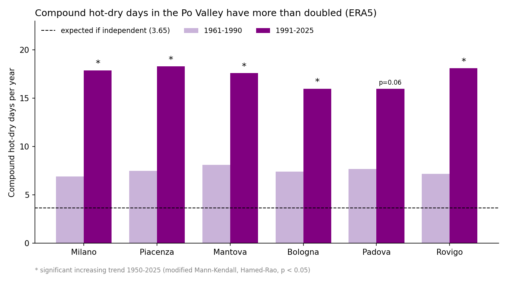
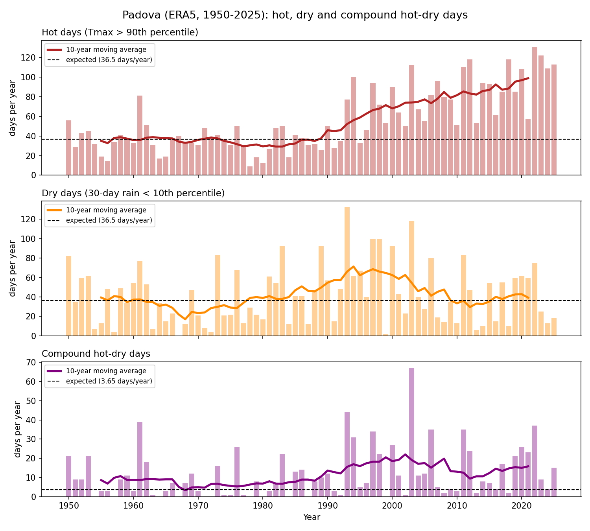

# Compound hot–dry extremes in the Po Valley (1950–2025) 

  

**Are hot and dry extremes happening together more often in northern Italy?**

This project uses 76 years of ERA5 reanalysis data for six cities in the Po Valley (Milano, Piacenza, Mantova, Bologna, Padova, Rovigo) to count **hot days**, **dry days** and **compound hot–dry days**, and to test whether they are increasing.

## Main findings

- **Hot days increased significantly in all six cities** (+6 to +12 days per decade, p < 0.001).
- **Dry days show weak or no trend**: significant only in Milano and Bologna.
- **Compound hot–dry days more than doubled**, from about 7–8 days per year in 1961–1990 to about 16–18 days per year in 1991–2025. The increasing trend is significant in **5 of 6 cities**; in Padova it is borderline (p = 0.06).
- Heat and drought are **not independent**: even in 1961–1990, compound days were about twice the number expected by chance (3.65 days per year), consistent with land–atmosphere feedbacks (dry soils warm the air).
- The increase in compound events is **driven mainly by warming**, not by more frequent droughts.
- The method picks up the well-known events on its own: **2003** (European heatwave, 67 compound days in Padova) and **2022** (historic Po drought).

| City | Hot days trend (days/decade) | Compound trend (days/decade) | Compound p-value | Compound days 1961–1990 | Compound days 1991–2025 |
|---|---|---|---|---|---|
| Milano | +11.9 | +1.7 | < 0.001 | 6.9 | 17.9 |
| Piacenza | +10.0 | +1.6 | < 0.001 | 7.5 | 18.3 |
| Mantova | +9.3 | +1.2 | 0.004 | 8.1 | 17.6 |
| Bologna | +6.2 | +1.4 | 0.009 | 7.4 | 16.0 |
| Padova | +9.7 | +0.8 | 0.062 | 7.7 | 16.0 |
| Rovigo | +8.7 | +1.4 | < 0.001 | 7.2 | 18.1 |



## Data

Daily maximum 2 m temperature and daily precipitation from the **ERA5 reanalysis** (Copernicus Climate Change Service), downloaded through the free [Open-Meteo historical weather API](https://open-meteo.com/) (CC BY 4.0), 1950–2025, at the grid point nearest to each city.

## Method

1. **Hot day**: daily Tmax above the **90th percentile** of the same calendar month in the reference period **1961–1990** (as in the ETCCDI index TX90p). Expected: 10% of days, about 36 per year.
2. **Dry day**: precipitation of the **previous 30 days** below the **10th percentile** of the same calendar month in 1961–1990. A 30-day window is used because most single days have no rain (the median daily rainfall is 0 mm), so drought is a deficit that builds up over weeks.
3. **Compound day**: a day that is both hot **and** dry. If heat and drought were independent, we would expect 0.1 × 0.1 = 1% of days, about **3.65 per year**.
4. **Trend test**: **modified Mann–Kendall test (Hamed and Rao, 1998)**, which corrects for autocorrelation between consecutive years, with **Sen's slope** for the size of the trend.

## Limitations

- ERA5 has a grid of about 30 km, so it smooths local extremes: daily rainfall maxima are lower and light-rain days more frequent than at a rain gauge.
- The ordinary Mann–Kendall test gave p = 0.024 for compound days in Padova, but the autocorrelation-corrected test gives p = 0.06, so single-city results should be read with care. The regional consistency across six cities is stronger evidence.
- Thresholds (90th / 10th percentile, 30-day window) are a choice; a sensitivity analysis with other thresholds would be a natural next step.

## How to run

```
pip install -r requirements.txt
python 01_download_data.py      # download ERA5 data (Open-Meteo) into data/
python 02_explore.py            # first look at Padova: annual Tmax and precipitation
python 03_compound_events.py    # hot, dry and compound days for Padova
python 04_plot.py               # 3-panel figure for Padova
python 05_trend.py              # Mann–Kendall trend test for Padova
python 06_all_cities.py         # all six cities + summary table
python 07_summary_plot.py       # summary figure
```

## References

- Zscheischler, J. et al. (2018). Future climate risk from compound events. *Nature Climate Change*, 8, 469–477.
- Hamed, K. H., & Rao, A. R. (1998). A modified Mann–Kendall trend test for autocorrelated data. *Journal of Hydrology*, 204, 182–196.
- Hersbach, H. et al. (2020). The ERA5 global reanalysis. *Quarterly Journal of the Royal Meteorological Society*, 146, 1999–2049.

## Author

Fatemeh Arab Sadeghabadi – MSc in Water and Geological Risk Engineering, University of Padova
